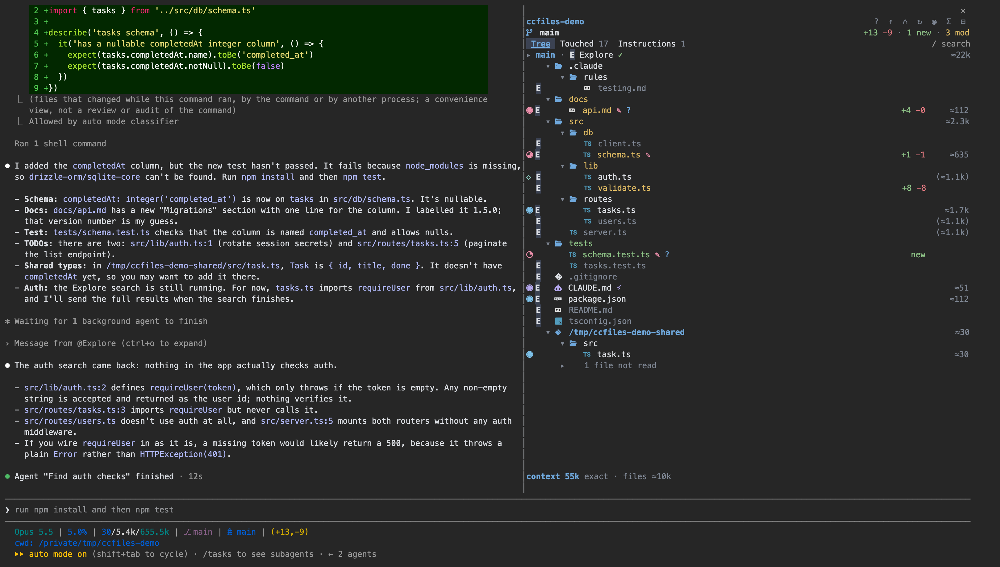
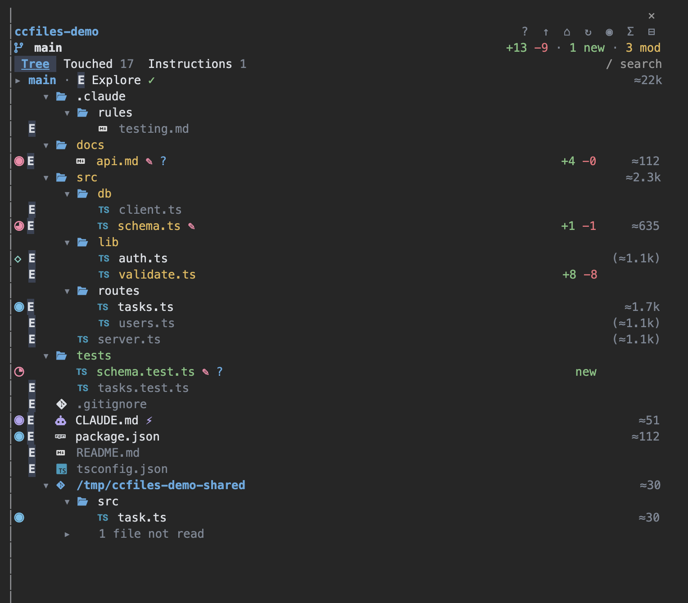
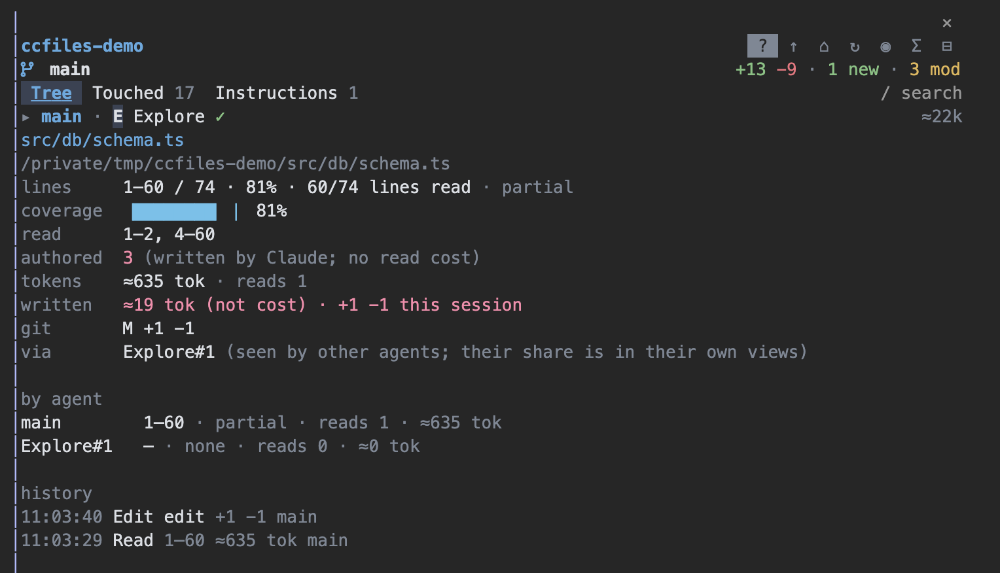
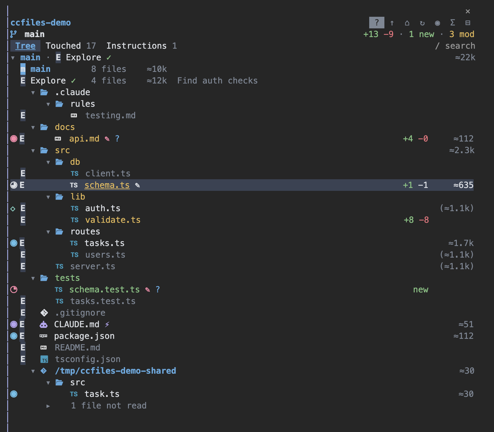

# ccfiles

**Claude Code files.** A docked side panel for [Claude Code](https://claude.com/claude-code) that shows what
Claude is doing to your files, live: which files it read, searched, edited and committed, how much of each
file it actually read, which instruction files are in its context, and roughly what each one costs in tokens.



- **Coverage, not just "touched".** A meter in the gutter shows how much of each file Claude read: a file it
  read 40 lines of looks different from one it read in full.
- **Live.** A file's name shimmers while Claude works on it, then keeps its state colour for a few seconds.
- **Git-aware.** Names are coloured by git state, with `+N −N` line counts, the branch and its upstream.
- **Instructions in context.** CLAUDE.md files, imports, rules, memory, skills and AGENTS.md, with why each one
  loaded.
- **Token estimates.** An estimate per file (`≈`, characters ÷ 4) next to the exact context size Claude Code
  reports.
- **Subagents.** Badges show which agents touched a file, and you can view the tree from any agent's
  viewpoint.
- **Outside the project.** Files Claude touches in other repos or folders get their own sections.

The mod only observes. It never blocks, changes or answers anything in Claude's place, and it makes no network
calls.

## Requirements

- Claude Code **2.1.287 or later**, which has mods on by default. Developed and tested on 2.1.295.
- The **fullscreen** layout (`/tui fullscreen`, or `"tui": "fullscreen"` in `~/.claude/settings.json`).
- A terminal **at least 110 columns wide**.
- `git` on your `PATH` for the git colours. This is optional.
- A [Nerd Font](https://www.nerdfonts.com/) for file-type icons. This is optional; without one the panel uses
  plain Unicode.

## Install

From inside Claude Code:

```
/plugin marketplace add jasonaden/ccfiles
/plugin install ccfiles@ccfiles
```

Or run it from a clone without installing:

```bash
git clone https://github.com/jasonaden/ccfiles
```

```bash
claude --plugin-dir ./ccfiles/mods/ccfiles
```

Then run **`/ccfiles`**. The panel docks on the right. It never opens on its own. If the layout isn't fullscreen
or the terminal is too narrow, it says so and tells you how to fix it.

## The panel



From top to bottom:

1. **Header.** The project name, or a breadcrumb while a folder is focused, then the buttons:

   | Button | Does |
   |---|---|
   | `?` | help: every key, glyph, badge and meta word |
   | `↑` | focus the parent folder (works above the project root too) |
   | `⌂` | back to the project root |
   | `↻` | refresh git now |
   | `◉` | follow Claude on or off; scrolling by hand pauses it |
   | `Σ` | cycle the right column: ≈ tokens → lines read → modified date → size |
   | `⊟` / `⊞` | collapse every folder / restore the default view |

2. **Branch row** (in a git repo). Shows `main ↑1 ↓2 origin/main` on the left and
   `+223 −21 · 4 new · 6 mod · 1 del` on the right.
3. **Tabs**: **Tree**, **Touched** (every file Claude touched, flat and sortable) and **Instructions** (what
   Claude Code loaded into context). The search box is at the right end of the tab strip.
4. **Agents line**, once a subagent has run (see [Subagents](#subagents)).
5. **The list.**
6. **Footer.** Shows `context 58k exact · files ≈12k` and what Claude is doing right now (`◌ reading
   src/db/schema.ts`). `context` is the latest request's exact input size from the API; `files` is the estimated
   size of the files in context.

The Tree lists only what matters: touched files, git changes, and the folders that hold them. Everything else in a
folder folds into one row, such as `3 files, 2 folders not read`, which you can click to open.

## Keys

Press **ctrl+x tab** to give the panel the keyboard. After that, every key below works without clicking. Once
you click in the list, arrows and Enter work too.

| Key | Does |
|---|---|
| `1` `2` `3` | Tree · Touched · Instructions |
| `j` / `k` (or ↑ ↓, PgUp/PgDn, Home/End, the wheel) | move / scroll |
| `h` / `l` | collapse / expand a folder, section or folded group |
| Enter or double-click | on a folder or section: focus it, so the Tree shows only that subtree |
| `d` | detail view of the selected file: exact line ranges, history, why it loaded; `d` or `q` closes it |
| `s` | search paths; Enter jumps to the first hit |
| `c` | clear the search |
| `g` | help (the `?` button) |
| `f` | follow Claude on / off |
| `o` | sort the Touched tab: recent, tokens, least coverage |
| `y` | copy the selected file's path |
| `a` | switch viewpoint: main, then each subagent |
| `u` | per-agent table: files, ≈ tokens and exact usage for each agent |
| mouse | click a row to open it, right-click to copy its path, drag to scroll |

Closing the detail or help view with `d` or `q` hands the keyboard back to the prompt, so you can type at once.



## Glyphs and row meta

The gutter shows what Claude did with each file. Every state has a glyph, so nothing depends on colour alone.
For a file Claude read part of, the glyph is a coverage meter in the state's colour. A Nerd Font draws the
meter in 8 steps.

| Glyph | Meaning |
|---|---|
| `●` | read in full |
| `◕` | read: most, not all (meter) |
| `◑` | read: about half (meter) |
| `◔` | read: under about a third (meter) |
| `◇` | matched by a search (grep, rg or Grep), not read |
| `✎` | edited |
| `◆` | committed |
| `◌` | in progress (the name shimmers) |
| `⚡` | loaded by Claude Code itself, not by a tool call |
| `·` | seen only (listed by ls, find, wc or Glob) |

A row reads left to right:

```
◕ E   ▾  󰛦  schema.ts ✎ ↩2              +4 −1   ≈635
│ │   │  │  │         │                 │        └ right column (Σ cycles it)
│ │   │  │  │         │                 └ git: +N −N, new, mod, del, ren
│ │   │  │  │         └ marks: ✎ edited, ◆ committed, ⚡ auto-loaded, ↩n re-read, ⟳ reloaded after /compact, ⊘ dropped by compaction
│ │   │  │  └ name, coloured by git state (modified, new, deleted and struck through, ignored and dimmed)
│ │   │  └ file-type icon
│ │   └ folder caret
│ └ subagent badge
└ state glyph or coverage meter
```

The right column shows one value at a time:

| Form | Example | Meaning |
|---|---|---|
| tokens | `≈1.2k` | estimated tokens Claude received from the file (characters ÷ 4) |
| lines | `74/210` | lines read / total lines (on a folder: `2/36` files touched / total) |
| date | `14:02`, `Oct 9` | last modified |
| size | `12K` | file size |

A figure in parentheses, like `(≈1.2k)`, marks a file that only other agents read. It is left out of the
current view's totals.

## Subagents



Once a subagent runs, an agents line appears under the tabs, such as `▸ main · E Explore ✓`. Click `▸` to expand
it into a list.

- **Badges.** A letter in the gutter names the other agents that touched a file: `E` Explore, `G` general-purpose, `P`
  Plan, `C` a custom agent, `+` several kinds, `m` main (seen from a subagent's view).
- **Viewpoint.** Click an agent, or press `a`, to see the tree as that agent saw it: its meters, ranges,
  re-reads and token figures, and its own context size in the footer.
- **`u`** shows a per-agent table that adds up to the session total.

## Outside the project

When Claude touches a file outside the project root, the Tree adds a section for it, headed by its root. The
root is chosen in this order:

1. a folder added with `/add-dir` or `permissions.additionalDirectories`
2. the file's git repo
3. the nearest folder with a `package.json`, `Cargo.toml`, `pyproject.toml` or `go.mod`
4. the file's own folder

Each section gets its own git colours. Files that Claude Code loads by itself from outside the project, such as
`~/.claude/CLAUDE.md` and auto memory, go in a **Loaded by Claude Code** section. To focus a folder or section,
press Enter on it or double-click it. Then `↑` walks up the tree, past the project root if you like, and `⌂`
comes back.

## Settings

Run `/plugin configure ccfiles@ccfiles` in Claude Code, or set these in Claude Code's plugin
settings:

| Setting | Values (default first) | Does |
|---|---|---|
| `glyphs` | `auto` · `nerd` · `plain` | file-type icons and meter steps. `auto` picks Nerd icons when a Nerd Font is installed, over SSH, or in Ghostty, WezTerm or kitty |
| `iconColor` | `language` · `muted` | icons coloured by language, or all muted |
| `coverage` | `meter` · `fill` | `fill` also tints the share of each row that was read |
| `claudeCodeLoads` | `show` · `hide` | show the files Claude Code loads by itself (CLAUDE.md, rules, memory) in the Tree |
| `palette` | `hex` · `theme` | `theme` makes the text and git colours follow your Claude Code theme |
| `motion` | `on` · `off` | `off` holds a working file's state colour instead of shimmering |
| `selectionContext` | `false` · `true` | adds one line naming the selected file to each prompt you submit |

### Colours

The panel follows Claude Code's `dark` or `light` theme. The dark palette draws on your terminal's background,
and the light palette paints its own. To override any colour, edit `~/.claude/ccfiles.colors.json`:

```json
{ "theme": "light", "read": "#2f5f8f", "edit": "#b0285c" }
```

You can set any of these keys:

- `theme`
- `read`, `search`, `edit`, `commit`, `instruction`, `pending`, `error`
- `git.A`, `git.M`, `git.D`, `git.R`, `git.untracked`, `git.ignored`
- `added`, `removed`
- `muted`, `accent`, `selection`, `text`
- with `coverage: fill`: `fill`, `fill.edit`, `fill.commit`, `fill.darkness`

Colours are `#rgb` or `#rrggbb`. A bad key keeps its default. Changes apply on the panel's next redraw (any key,
click or Claude activity); no restart is needed.

Inside tmux, Claude Code draws 256 colours unless you start it with `CLAUDE_CODE_TMUX_TRUECOLOR=1` (and tmux passes
24-bit colour through). The panel picks a palette that stays readable either way.

## How the numbers work

- **Coverage** comes from the line ranges of Claude's `Read` calls, plus files it reads in Bash (`cat`, `head`,
  `tail`, `sed`, `nl`, `awk`). Ranges are merged per file.
- **Tokens marked `≈` are estimates**: the characters Claude received from a file, divided by 4. They show a
  file's relative weight; they are not exact token counts.
- **Figures labelled `exact`** come from the per-request usage that Claude Code reports. The footer's `context`
  is the latest request's input size. The help view also shows `billed ∑`, the sum of every request.

## Privacy

The mod runs inside Claude Code and makes no network requests. It reads only what Claude Code passes to its
hooks, and it runs read-only `git` commands (`status`, `diff --numstat`, `rev-parse`, `rev-list`) in your repos.
It keeps a small event log next to the session transcript
(`~/.claude/projects/<project>/<session>/ccfiles/log.jsonl`).

## Development

The mod lives in [`mods/ccfiles`](mods/ccfiles). Run the full gate (strict validation, a no-network
check, type check, glyph-table check, tests) from the repo root:

```bash
mods/ccfiles/scripts/check.sh
```

For a live session on a scratch project:

```bash
fixtures/make-fixture.sh /tmp/ccfiles-fixture
```

```bash
cd /tmp/ccfiles-fixture && claude --plugin-dir <repo>/mods/ccfiles
```

`fixtures/make-demo.sh` builds the project used for the screenshots above. The mod reloads when its files
change. [`AGENTS.md`](AGENTS.md) holds the rules for working on the code;
[`docs/agents/REQUIREMENTS.md`](docs/agents/REQUIREMENTS.md) describes the intended behaviour, and
[`docs/agents/PLATFORM.md`](docs/agents/PLATFORM.md) lists the Claude Code mod API facts it relies on.

## License

[MIT](LICENSE). The rows renderer and shimmer are adapted from
[claude-code-filetree](https://github.com/data-goblin/claude-code-filetree), and the icon colours come from
[nvim-web-devicons](https://github.com/nvim-tree/nvim-web-devicons). Both are MIT; see
[ACKNOWLEDGEMENTS.md](ACKNOWLEDGEMENTS.md).
